# Sky Hop

**Run, climb and swing through 17 worlds of tech, as a little orange Claude or one of ten other AI characters.**
Every platform is a line of code from the world you're in, every world has a creature of its own and a boss guarding its way out, and old-tech tunnels take you under the worst of it, like pipes in a platformer. It never ends: after the seventeenth world you go round again, and everything is tougher. The same game runs as 16-bit pixel art in the browser and as coloured ASCII in a terminal.

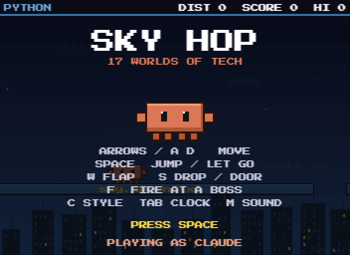

## Play it

You need [Node.js](https://nodejs.org) 18 or newer. There's nothing to install.

| Where | How |
| --- | --- |
| **Browser** (16-bit) | `node serve.mjs`, then open <http://localhost:8765> (set `PORT` to use another port) |
| **Terminal** (ASCII) | `node play.mjs` in a window at least 46 columns by 26 rows |

### Controls

| Key | What it does |
| --- | --- |
| `A` `D` or `←` `→` | Run left and right. On a rope, lean into the swing. |
| `Space` | Jump. On a rope, let go. |
| `W` or `↑` | Jump, or flap once in mid-air for a little extra height. |
| `S` or `↓` | Drop through the platform you're on, or **go down a door**. |
| `F` or `E` | Throw a mini fireball at the boss (only in a boss fight). |
| `C` | On the title screen, open the **wardrobe** to pick a character and what it wears. |
| `Tab` | Autopilot. In the browser it also puts the time up over the game, like a screensaver. |
| `R` | Start again after a game over. |
| `M` | Sound on or off (browser). |
| `Q` | Quit (terminal). |

On a phone, the browser version shows on-screen buttons, including **FIRE** and **STYLE** (the wardrobe). Tapping the game also jumps.

To start further on, in a world of your choice: add `?world=5` to the browser address, or run `node play.mjs world 5`.

## Characters and clothes

Press **`C`** on the title screen to open the **wardrobe**. Pick who plays and dress them up:

- **11 characters**: Claude, GPT, Qwen, Grok, Hugging Face, OpenClaw, Gemini, DeepSeek, Llama, Mistral and Copilot. They're little pixel creatures in each model's colours, not logos, and each has a shape of its own: OpenClaw has claws, DeepSeek has a whale's tail, Llama has ears, Hugging Face holds its hands out for a hug, and Copilot comes in a pilot's cap.
- **Hats**: cap, top hat, crown, beanie, wizard hat, party hat, propeller cap, and spiky hair in black or glowing gold.
- **Eyewear**: sunglasses, round glasses, VR visor, monocle, pixel shades, 3D glasses.
- **Clothes**: tie, bow tie, scarf, hoodie, a cape that flows behind you, and a lab coat.

`W`/`S` picks a row and `A`/`D` changes it (the arrow keys work too, in the browser), `X` dresses you at random, and `Space` is done. It's only looks: every character is the same size and plays exactly the same. Your look is remembered, in the browser's storage or in `look.txt` for the terminal, and it stays on when you restart.

| | |
| --- | --- |
| 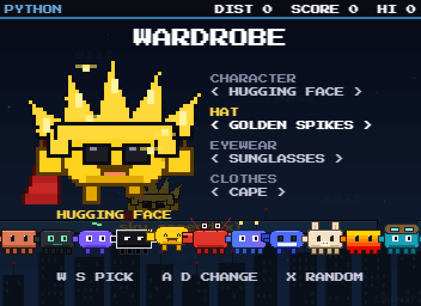 | 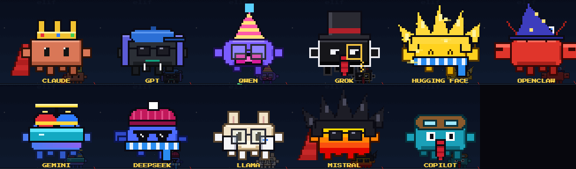 |
| The wardrobe | All 11 characters, each in something different |

## How a run goes

The world is one long chain: you **run** along the ground, left or right, then **climb** up a column of platforms to a cloud. A **boss** waits on every cloud, and beating it opens the way into the next world. Every world is a bit harder than the one before. After the seventeenth world you start over at the first, on the next **lap**, and it keeps getting harder.

Platforms come in a few kinds:

- **Plain**: a line of the world's code, safe to stand on.
- **Sliding**: arrows at both ends, moving back and forth. It carries you with it.
- **Crumbling**: old code turned to stone. It cracks once you're on it and soon gives way, then grows back a few seconds later.
- **Spring** (`+`): throws you high.
- **Syntax error** (`!!!`): red spikes on one end of a line. Land on the clean part.

Lightning strikes are **exceptions**: a red column warns you where one will land a moment before it does.

## The 17 worlds

The worlds come in a fixed order that mixes languages, systems and the places code lives. Each one has its own creature, and each creature moves in its own way. They're only names and colours, not logos.

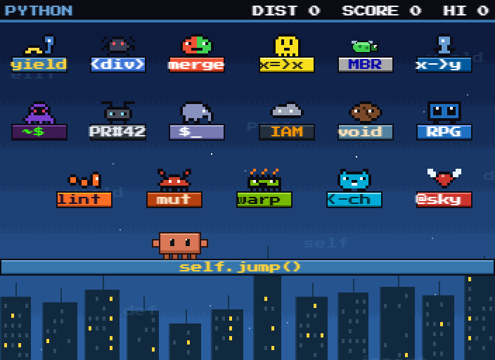

| # | World | Creature | How it moves |
| --- | --- | --- | --- |
| 1 | Python | snake | walks its platform |
| 2 | WWW | web spider | hangs on a thread and drops on you |
| 3 | Git | merge conflict | hops along |
| 4 | JavaScript | NaN ghost | swoops down at you |
| 5 | BIOS | bug | flies back and forth |
| 6 | C++ | dangling pointer | hangs on a thread and drops on you |
| 7 | Dark Web | phantom | swoops down at you |
| 8 | GitHub | bot drone | swoops down at you |
| 9 | PHP | elephant | walks, slowly |
| 10 | AWS Cloud | storm cloud | flies back and forth |
| 11 | Java | coffee bean | hops along |
| 12 | IBM | tape-reel robot | walks its platform |
| 13 | GitLab | pipeline worm | walks its platform |
| 14 | Rust | crab | walks, fast |
| 15 | Nvidia | overheating chip | hops along |
| 16 | Go | gopher | hops along |
| 17 | Ruby | winged gem | flies back and forth |

A few ways to get past them:

- **Walkers and hoppers** only hurt at their own height, so you can jump over them.
- **Droppers** hang over the far end of a long platform. They only drop on you if you walk underneath, so jump past them.
- **Swoopers** dive at you from above and then go back up. Move out of the way of the dive.
- **Fliers** fly back and forth, so time your jump between passes.

On a climb every platform is the only way up, so ground creatures fly there instead of blocking it.

| | | |
| --- | --- | --- |
| 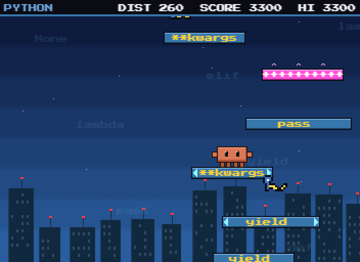 | 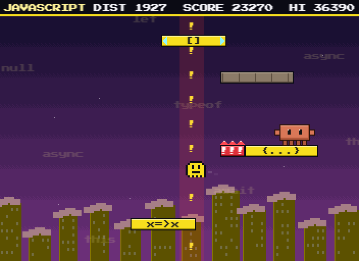 | 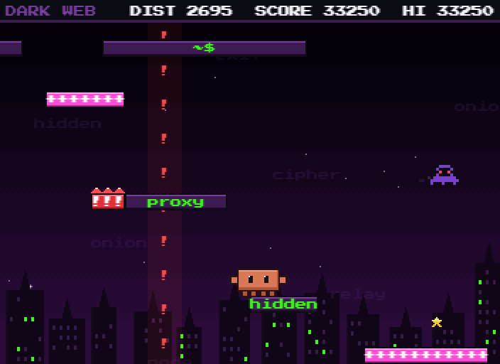 |
| Python | JavaScript | Dark Web |
| 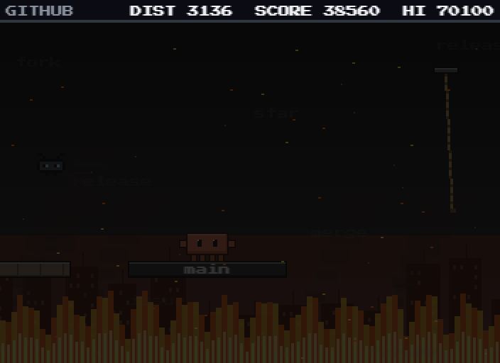 | 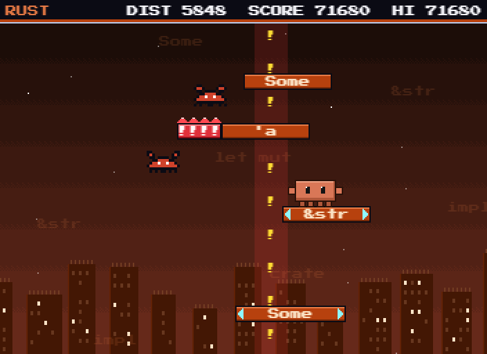 | 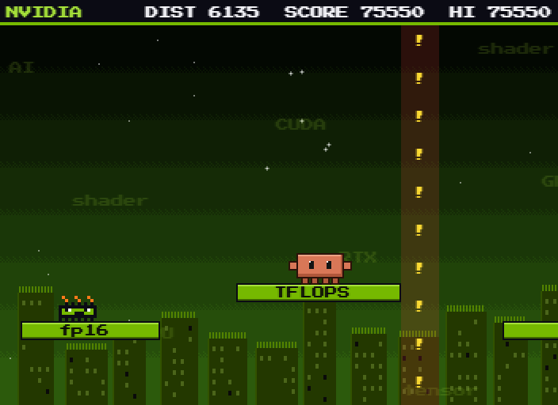 |
| GitHub | Rust | Nvidia |

## Bosses

Reaching a world's cloud top starts a **boss fight**. The screen locks onto the cloud, glowing walls go up at both ends, and three ledges appear to dodge onto. You get **three hearts** for the fight. After a hit you flash, and can't be hit again for a moment. Lose all three and the game is over.

Press **`F`** (or `E`) to throw mini fireballs. They fly across the arena at the boss, at the height you throw them from, up to three at a time. The boss's health is the bar along the top. When it's empty the boss bursts, the cloud opens, and you get a bonus.

Every attack **warns you first**, like everything else in the game. A red mark shows where something will land, a flashing `!` and arrow show which wall something will come through, and a boss shakes with a `!` over it before it charges, leaps or dives.

**Mini bosses** guard most worlds. Each is a giant of its world's own creature and fights the way that creature moves: the King Snake charges along the ground, the Mother Spider drops on you and waits there (a good moment to hit it), the Phantom Lord dives, the Thunderhead rains on you, and the hoppers leap at you and send a shockwave along the ground both ways when they land.

**Big bosses** guard every fourth world and the last one:

| After world | Boss | What it does |
| --- | --- | --- |
| 4, JavaScript | **Blue Screen** | Fires rows of `ERROR` across the arena, at different heights |
| 8, GitHub | **Stack Overflow** | Drops stack frames on you, and slides one along the ground |
| 12, IBM | **Y2K Bug** | Lobs bombs that burst wide, and leaps at you |
| 16, Go | **Kernel Panic** | Calls down lightning, and charges |
| 17, Ruby | **Legacy Monolith** | The final boss: errors and bombs, then more of everything as it weakens |

| | | |
| --- | --- | --- |
| 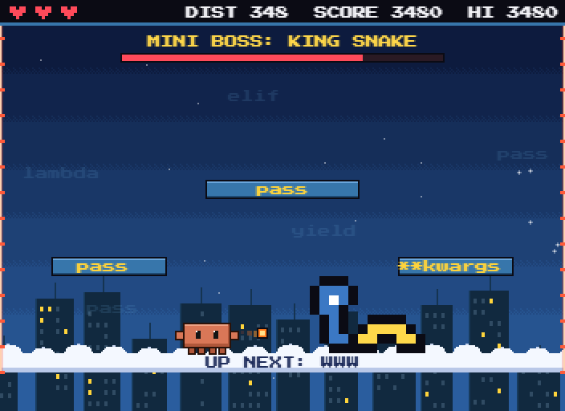 | 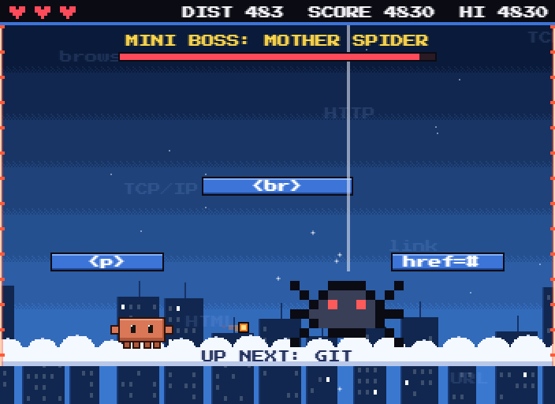 | 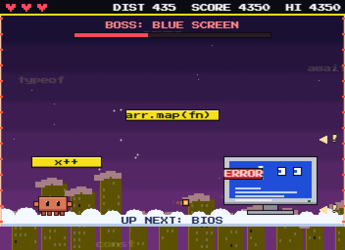 |
| King Snake | Mother Spider, down on the cloud | Blue Screen, and its errors |
| 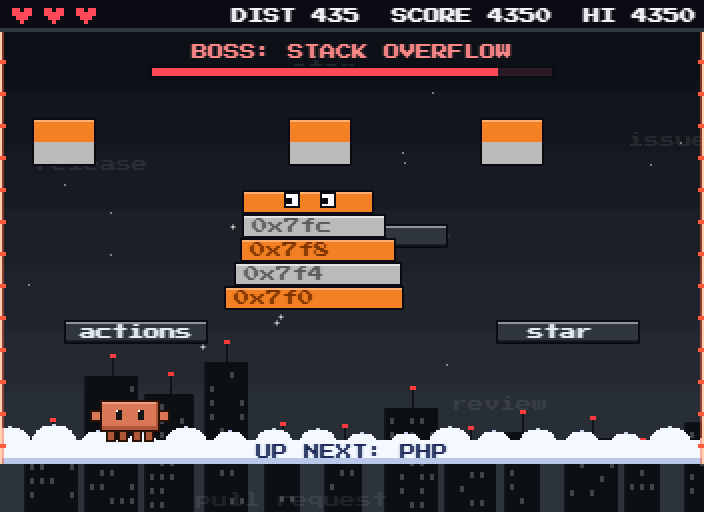 | 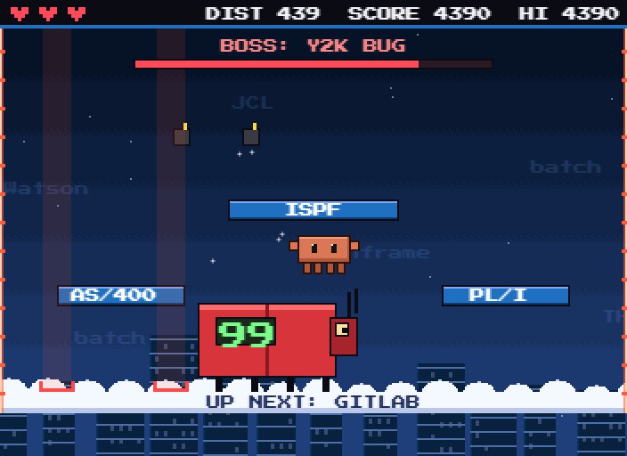 | 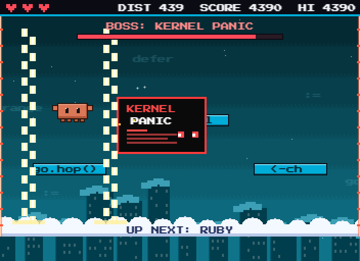 |
| Stack Overflow, frames falling | Y2K Bug, bombs on their way | Kernel Panic's lightning |

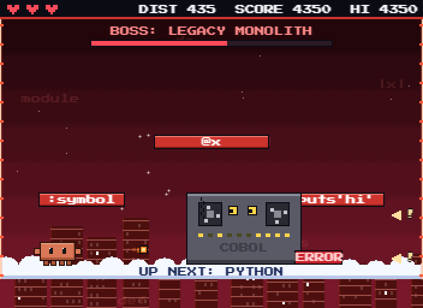

### Laps

Beating the Legacy Monolith doesn't end the game. You go back to the first world, on **lap 2**, and then lap 3, and so on, for as long as you last. Every lap:

- each boss has **40% more health** than on the lap before, moves faster, throws more at once and rests less between attacks;
- warnings get **shorter, but never shorter than 0.6 seconds**;
- from lap 3, mini bosses have also learned the Blue Screen's rows of errors;
- the ground is harder: fewer plain platforms, shorter ones, wider gaps (never too wide to jump), more creatures, and lightning more often.

The lap you're on shows in the score bar once you're past the first, and the boss bonus grows with it.

## Doors and tunnels

About half of all runs have a **door** in them, marked with the name of an old technology. It works like a pipe in a classic platformer: right after every door the ground turns **very hard**. For about 80 cells there are only tiny pieces of platform. They crumble, slide or carry syntax errors, they're 15 to 19 cells apart (a full running jump only just reaches 25), and creatures crawl over them. You can make it across, but only just.

The easy way is under it. Stand in the doorway and press **`S`** to drop into that technology's tunnel: **COBOL, Assembly, FORTRAN, Punch card** or **BASIC**. A tunnel is a short dark run full of stars, with a few bugs. Walk into the **EXIT** at the far end and you come back up on solid ground past the whole hard stretch, with 100 bonus points. The autopilot always takes the door.

| | |
| --- | --- |
| 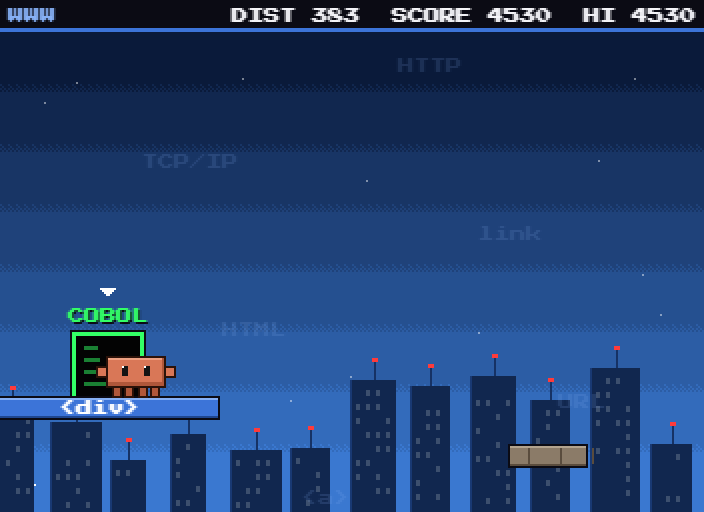 | 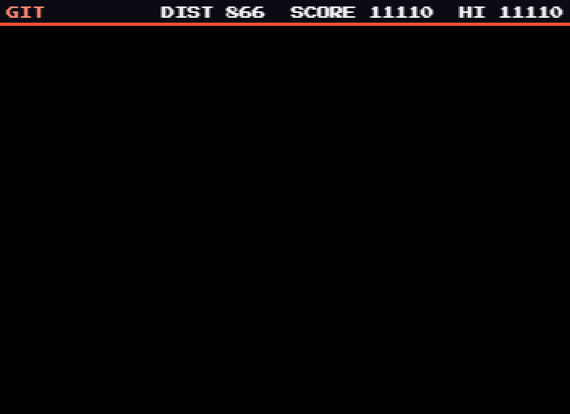 |
| A door, with the hard ground beyond it | Inside a BASIC tunnel |

## Ropes

Some gaps are too wide to jump, and ropes hang over them. Jump at a rope and you grab it by yourself. Lean into the swing with `A`/`D` to swing higher, then press `Space` to let go and fly off the way you were going.

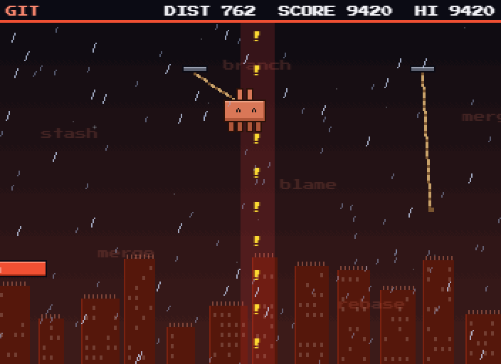

## Weather and disasters

The sky keeps changing: **clear, rain, thunderstorm, sandstorm, snow** and **fog**, with a long calm between **disasters**. A seed always gives the same world and the same weather.

Four of them are part of the rules, and **each one warns you first**:

| | What happens | The warning |
| --- | --- | --- |
| **Meteor shower** | Meteors kill whatever they land on, and smash platforms that aren't on the way forward. | A blinking red target where each one will land, about 1.5 seconds before it does. |
| **Volcano** | Lava bombs kill what they hit and leave that patch of platform burning for a few seconds. | An orange target where each one will land. |
| **Wildfire** | A platform catches fire, and standing in the flames kills you. | The platform smokes for two seconds first, getting thicker before it catches. |
| **Sandstorm** | The wind pushes you sideways, a little on the ground and a lot in the air. It never hurts by itself. | Sand blowing across the screen, and the wind's direction on the banner. |

**Earthquakes, tornadoes, floods, rain, snow, fog** and the thunderstorm's far-off lightning are only for looks. Nothing happens underground.

| | | |
| --- | --- | --- |
| 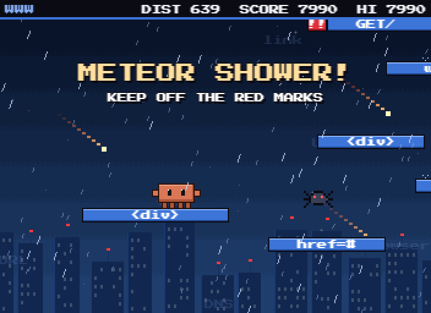 | 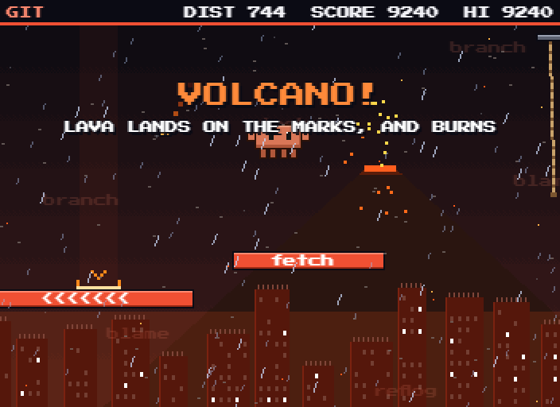 | 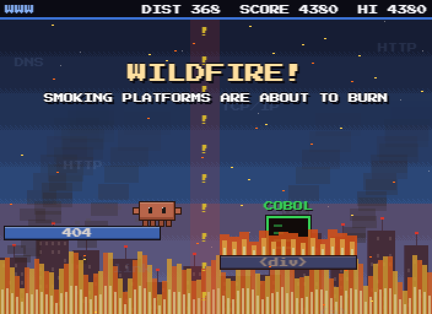 |
| Meteor shower: keep off the red marks | Volcano: a lava target, and a platform still burning | Wildfire: one platform burning, others smoking |

To see one for as long as you like:

- **Browser:** add `?sky=` to the address, like <http://localhost:8765/?sky=volcano> or `?sky=meteor-shower`.
- **Terminal:** `node play.mjs volcano` or `node play.mjs meteor shower`.

## Score

Your **score** is your distance × 10, plus your bonuses: **50** for a star, **100** for coming out of a tunnel, and for beating a boss **1,000** (a mini boss) or **3,000** (a big boss) times the lap you're on, plus **500** for the new world it opens. Your best score is saved: the browser keeps it in local storage, and the terminal keeps it in `best.txt`. A run where you used the autopilot doesn't count toward your best.

## Autopilot and clock

Press **`Tab`** and the game plays itself, and it's good at it. It swings on ropes, takes every door, dodges the creatures, meteors, lava and fire, and fights the bosses. It beats every boss on the first lap, but later laps can beat it. In the browser the screen turns into a clock: the time, the date and the seconds going by, with the game still playing behind it. Press `Tab` again to take back over.

| | |
| --- | --- |
| 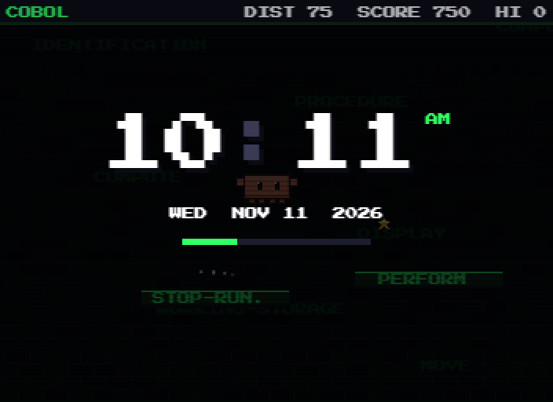 | 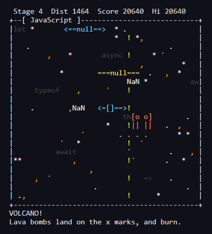 |
| `Tab` in the browser: a clock over the game | The terminal version, in a volcano |

## For developers

```bash
node --test test.mjs     # 75 tests, about 40 seconds
```

The tests cover the moves, ropes, doors and tunnels, every kind of creature movement, every dangerous disaster (each one only hurts after its warning), and the wind. For the bosses they cover fireballs, hearts, the arena's walls, every attack's warning on several laps, and each lap getting harder. For the characters they check every character in every hat, eyewear and clothes fits the terminal, that a look saves and loads, and that a run plays out exactly the same whatever you wear. The autopilot also beats every boss, plays through all 17 worlds and back to the first, and takes every door it comes to.

Add `?debug` to the browser address to get the live game as `window.skyHop` in the console.

| File | What's in it |
| --- | --- |
| `game.mjs` | The rules, shared by both versions: moving, jumping, ropes, doors, tunnels, scoring, one tick at a time |
| `world.mjs` | Builds the world ahead of you: runs, climbs, the hard ground after a door, tunnels, where creatures go |
| `hazards.mjs` | How each creature moves, and the meteors, lava, fire and wind |
| `bosses.mjs` | The boss fights: every boss, its attacks and their warnings, fireballs, hearts, and laps |
| `weather.mjs` | Which weather and disaster is on at any moment, from a seed |
| `places.mjs` | The 17 worlds and 5 tunnel eras: their colours, code, words and creatures |
| `looks.mjs` | The characters, hats, eyewear and clothes, and the wardrobe that picks them |
| `autopilot.mjs` | The autopilot: it tries out its moves ahead of time on a copy of the game |
| `index.html` | The 16-bit browser version: pixel art, sound and the clock |
| `terminal.mjs`, `play.mjs` | The ASCII version and its launcher |
| `serve.mjs` | A tiny local web server for the browser version |
| `test.mjs` | The tests |
| `docs/` | The pictures in this README |
